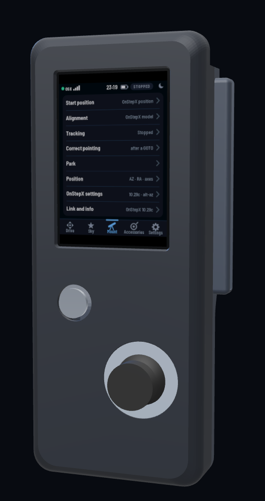
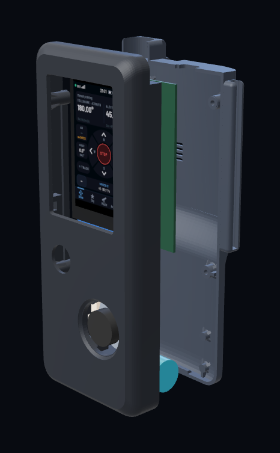
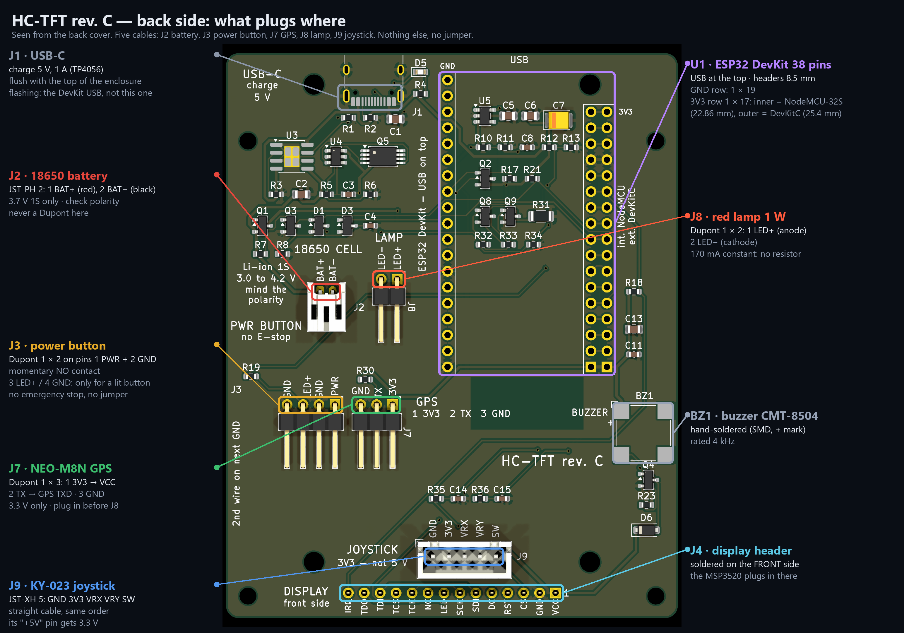

# SHC-OnStepX — 3.5″ touch Wi-Fi hand controller for OnStepX (main)

**Live page:** https://christm45.github.io/shc-onstepx-remote/ — the real enclosure in 3D with the actual firmware
(compiled to WebAssembly) running on its screen, a test bench, the user guide, the wiring, pictures and all the files.

 

## What it is

A wireless hand controller for an **OnStepX** telescope controller (main branch, 10.29c). It joins OnStepX's Wi-Fi
(access point "OnStep", or a home router) and speaks LX200 over TCP port 9999. Not the official OnStep SHC: a
separate touch-screen design.

- **ESP32 DevKit** (38 pins) and a **3.5″ lcdwiki MSP3520** display (ILI9488 + XPT2046 resistive touch, 320 × 480).
- **KY-023 joystick**, **NEO-M8N GPS** (site and UTC time), **1 W deep-red lamp**, 16 mm power button with a red ring.
- **18650** cell, charged (USB-C, 1 A) and protected on the board; automatic power-off before deep discharge.
- Uses OnStepX's own commands only: GOTO in apparent coordinates of date, OnStepX alignment (:A1…:A9, :A+, :AW),
  park / home, limits, meridian flip, PEC, backlash, tracking rates, focuser (:F), derotator (:r), auxiliary outputs and
  dew heaters (:GXY/:GXX/:SXX), sites. Arrows on :R0–:R9.
- Catalogues on board: 8,400 stars, 13,000 deep-sky objects, double and variable stars, clusters, planets, Moon.
- No emergency-stop button: **STOP held 1 s** on the screen stops axes, tracking, focuser and derotator.
- Optional ASCOM bridge (port 4030) to drive the mount from a PC through the hand controller.

Tested on the author's unit. The command set was checked line by line against the OnStepX 10.29c source.

## Files

| Folder | Content |
|---|---|
| [`downloads/pcb_smd_revC/`](downloads/pcb_smd_revC/) | **HC-TFT rev. C** (SMD, JLCPCB assembly Bottom side, 51 parts): `HC-TFT_gerbers.zip`, `HC-TFT_JLCPCB_BOM.csv`, `HC-TFT_JLCPCB_CPL.csv`, `HC-TFT_hand_solder.csv` |
| [`downloads/pcb_tht_revB/`](downloads/pcb_tht_revB/) | **HC-TFT-T rev. B** (through-hole, solder it yourself): Gerber zip; optional JLCPCB BOM/CPL |
| [`downloads/stl/`](downloads/stl/) | Enclosure to print: `front`, `back_cover`, `joystick_cover`, `foot_pad` (×2), `joystick_template`; `tht/` for the through-hole board |
| [`downloads/PARTS_LIST.md`](downloads/PARTS_LIST.md) | Every part with requirements, links, indicative prices; wiring table; printing settings |
| [`img/`](img/) | Annotated board renders (what plugs where), PCB renders, STL renders; [`img/enclosure/`](img/enclosure/): the enclosure part by part and assembled |

Board: 72 × 90 mm, 2 layers, 1.6 mm. Enclosure: 80 × 195 × 39 mm, black PETG or ASA.

## Before you build

1. **Display:** check "ILI9488" on the module and **bridge its jumper J1** (it is fed 3.3 V; lcdwiki schematic).
2. **DevKit:** measure the row spacing — 22.86 mm (NodeMCU-32S, most clones) → inner 3V3 row "int. NodeMCU";
   25.4 mm (Espressif DevKitC V4) → outer row "ext. DevKitC".
3. **GPS:** board 32 × 32 mm, ≤ 9 mm thick, 25 × 25 patch; its regulator must work from 3.3 V (not an AMS1117).
4. **Joystick:** print `joystick_template.stl` and check its 4 holes before printing the enclosure.
5. **Battery:** 3.7 V 1S only, check the polarity of the holder wires before plugging J2.

| Board connector | Goes to |
|---|---|
| J2 1 BAT+ / 2 BAT− | 18650 holder (JST-PH) |
| J3 1 PWR / 2 GND / 3 LED+ / 4 GND | power button NO / C / ring + / ring − |
| J7 1 3V3 / 2 TX / 3 GND | GPS VCC / TXD / GND |
| J8 1 LED+ / 2 LED− | lamp LED |
| J9 GND / 3V3 / VRX / VRY / SW | KY-023 (its "+5V" pin gets 3.3 V) |
| J4 (front side) | the MSP3520 display, plugged in |

## OnStepX side

`SERIAL_IP_MODE WIFI_ACCESS_POINT` (or `BOTH` with a home router) in OnStepX's `Config.h`. Factory values used by the
hand controller: network `OnStep`, password `password`, address `192.168.0.1`, port `9999`. Port 9999 takes one
client: other apps use 9996–9998.

## License

Same license as OnStepX: **GNU General Public License v3.0 or later** — see [LICENSE](LICENSE). The board,
enclosure and documentation files of this repository, and the firmware build running on the page, are free: you may use, modify and share them, and
derived works must stay under the same license.
